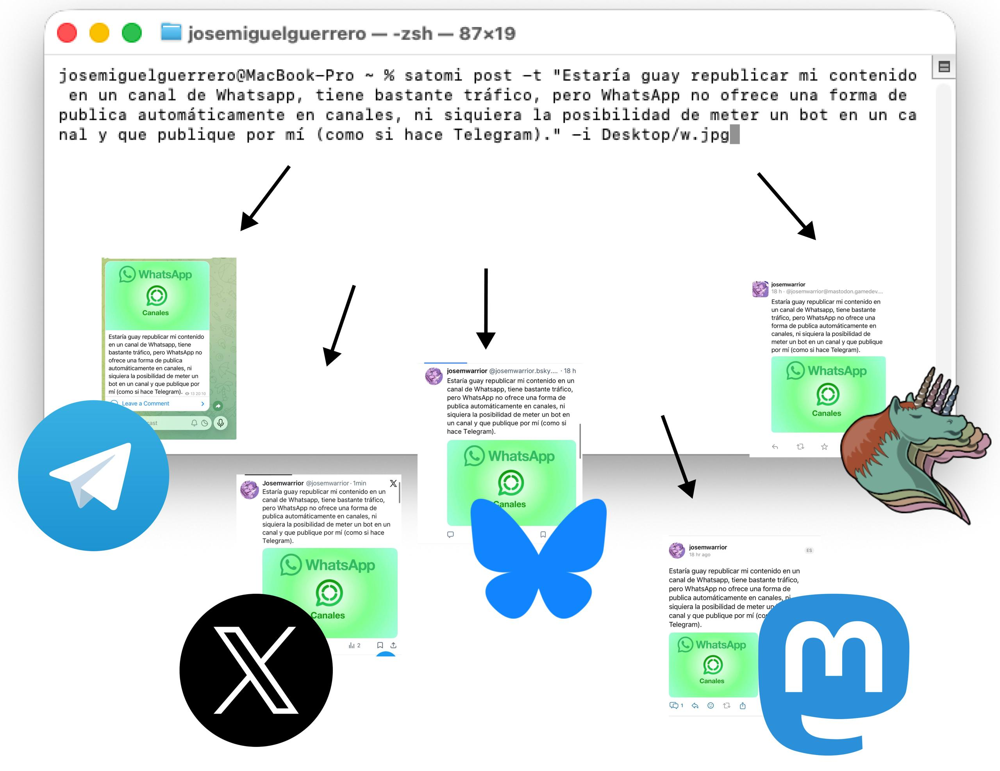

## What is Satomi?

Satomi-2000 is a CLI that publishes to Jekyll and optionally syndicates to Mastodon, Bluesky, X, Telegram, and Org Social.

It supports text, local or HTTPS images (PNG, JPEG, WebP, animated GIF), and external MP4 URLs.

## How to install

Requires Node.js 20+, Git, and your Jekyll toolchain. Video support also requires FFmpeg.

```bash
npm install
npm run build
cp satomi.config.example.yml satomi.config.yml
cp .env.example .env
```

Edit `satomi.config.yml` and add credentials for enabled platforms to `.env`.

## How to use it

```bash
# Interactive
satomi

# Text
satomi post -t "A new update."

# Image or GIF (text is optional)
satomi post -t "New animation." -i capture.gif
satomi post -i capture.png

# External image (direct URL; text is optional)
satomi post -i "https://i.imgur.com/IDENTIFIER.jpeg" -a "Image description"

# External MP4 (text is optional)
satomi post -t "New gameplay." -v https://example.com/video.mp4
satomi post -v https://example.com/video.mp4

# Bypass the local daily X limit (and authorize an X payload containing a URL)
satomi post -t "Extra update" --force-x
```

Need another option? Run `satomi --help`.

Bare `https://` and `http://` links in post text become explicit `[[URL][URL]]` text links in `social.org`. Existing links and code are preserved. An explicit `org_social_text` override is used unchanged.

## Long posts and automatic threads

Open `preview.html` from the repository root directly in your browser to try the splitter. Write plain text on the left and switch network tabs to inspect the read-only parts on the right. Everything runs locally, with no server or Internet connection. Per-post limits are adjustable; Telegram also lets you preview a first part with media. The HTML bundles the same `src/threads.ts` implementation used by the CLI, including X's weighted counting. `npm run build` refreshes it automatically; `npm run build:preview` refreshes just this tool.

There is no limit on the complete draft's length. Jekyll, RSS, JSON Feed and Org Social keep the complete post. Satomi independently divides each social payload (including its configured tags and canonical URL) into as many posts as needed.

Cuts occur between whole words. Satomi reserves space for three literal dots at every continuation:

```text
First part of the post...
...the next part continues...
...and this is the last part.
```

No part numbers are added. Spaces and paragraphs within a part are preserved; whitespace at a cut is trimmed. Media and its alternative text appear only on the first part. Tags and the canonical URL are appended once to the complete payload before splitting.

`platforms.<name>.max_characters` now controls each part, not the draft. A smaller configured value is respected; raising it does not bypass the native X, Bluesky or Telegram limits. A single word or URL that cannot fit with the required dots produces an explanation before publication: Satomi never truncates it or cuts it in half.

### API support

References checked on September 15, 2026:

| Destination | How continuations are linked | Limit per part |
| --- | --- | --- |
| Mastodon | `POST /api/v1/statuses` with `in_reply_to_id` pointing to the previous part. [Statuses API](https://docs.joinmastodon.org/methods/statuses/) | Configured limit, reduced to the instance's advertised limit during preflight. URL counting uses its reserved URL length. [Instance configuration](https://docs.joinmastodon.org/entities/Instance/) |
| Bluesky | Each `app.bsky.feed.post` record references the first part in `reply.root` and the previous part in `reply.parent`, both with URI and CID. | 300 graphemes and 3000 UTF-8 bytes. [Post lexicon](https://github.com/bluesky-social/atproto/blob/main/lexicons/app/bsky/feed/post.json) |
| X | `POST /2/tweets` with `reply.in_reply_to_tweet_id`. [Manage Posts](https://docs.x.com/x-api/posts/manage-tweets/introduction) | 280 weighted characters, including X's URL weighting. [Character counting](https://docs.x.com/fundamentals/counting-characters) |
| Telegram | The Worker sends each continuation with `reply_parameters.message_id` in the same channel. These are linked channel messages; no separate forum topic is created. | 4096 characters for text; 1024 for the first part when used as a media caption. [Bot API](https://core.telegram.org/bots/api#sendmessage) |
| Org Social | Supports `REPLY_TO`, but Satomi keeps a single complete post here as no protocol length limit requires splitting. [Specification](https://org-social.org/docs.html) | No configured text cap. |

X's current documentation also restricts replies for self-serve accounts to cases where the original author mentioned or quoted the replying account. It advertises thread creation but does not explicitly clarify the self-reply exception. Satomi implements native self-replies; account eligibility has to be confirmed with X. A rejection stops that network's thread and retains the confirmed parts. [X reply restrictions](https://docs.x.com/x-api/posts/manage-tweets/introduction)

X's local daily allowance and cost guardrail count every pending part, with the URL cost applied only to parts containing URLs. `--force-x` authorizes URLs and bypasses the daily allowance; the configured cost ceiling still applies to the sum. The legacy `max_posts_per_run: 1` field is accepted but no longer limits threads.

### Deployment and recovery

Update the Telegram Worker from `telegram_bot/` before publishing Telegram threads. Its `/validate` response must advertise `supportsReplies: true`; older Workers still work for single posts. Existing configurations with `telegram.max_characters: 1024` keep that smaller per-part limit; change it to `4096` to use the full text-message allowance.

`satomi validate -t "..."` checks the draft and shows the number of posts for each network without publishing. Publication summaries show progress and link to the first part. Each part's text, status, remote reference and Bluesky record key are saved locally. `satomi retry` continues from the failed part with the original cuts, skipping confirmed parts. An uncertain write remains blocked until manually reconciled to prevent duplicate posts. API rate limits may interrupt a long thread; confirmed parts remain available for recovery.

If Git push fails after the blog commit, or deployment times out before social publishing starts, resolve the Git/deployment problem and run `satomi retry A000001` (replace the ID with the one in `satomi history`). Satomi sends the existing commit, waits for the public page and media, and then publishes to the original social destinations. It keeps the same blog entry, image, and saved thread cuts. Existing failed attempts showing `manual-check` for these phases are also supported; no state-file edits are needed. Any evidence of an earlier social request keeps this recovery blocked.

For failures after social publishing has started, use the per-platform retry command shown by `satomi history`. Pending or unknown writes still require manual reconciliation.

Telegram continuations are spaced by one second to follow its [per-chat rate recommendation](https://core.telegram.org/bots/faq#my-bot-is-hitting-limits-how-do-i-avoid-this).

## How Org Social is updated

When Org Social is selected, Satomi appends only the new post to the end of the existing `social.org`. The header, previous posts, replies, reactions, and manual edits are preserved exactly. Posts created with other clients do not need a matching Jekyll entry to survive the next publication. Keep the local file up to date with those changes before publishing.

RSS and JSON Feed are still regenerated from the Jekyll entries. Editing or deleting an old Jekyll entry no longer changes `social.org`; edit the Org file directly when needed. Profile settings in the configuration initialize a missing file; update an existing profile in `social.org` itself. New posts still use `org_social.default_language`.

Only if `social.org` does not exist does Satomi create it from the opted-in Jekyll history, in chronological order. To include a reply in that initial import, store its metadata in the Jekyll entry:

```yaml
syndicate:
  org_social: true
  org_social_language: es
  org_social_client: iOS
  org_social_reply_to: 'https://example.com/social.org#2026-08-11T10:43:16+0200'
org_social_text: |-
  [[org-social:https://example.com/social.org][alice]] Reply written in Org syntax.
```

`org_social_text` is optional. Use it when the Jekyll body is Markdown and the Org Social version needs Org links or mentions. These historical fields are used only when creating a missing `social.org`; they do not overwrite an existing Org post or syndicate it again.

## External images

`-i` accepts a local path or a direct HTTPS image URL. Satomi downloads and validates remote images in a temporary directory, then uploads the file to Mastodon, Bluesky, and X. Telegram receives the public URL (WebP is sent as a document; GIF as an animation). GIF conversion for Bluesky still requires FFmpeg.

Jekyll's `image` front matter, RSS, JSON Feed, and Org Social retain the original external URL. No image is copied into the blog repository. The image server must allow public downloads and embedding and return the correct image Content-Type. HTML gallery pages are not supported. URLs may contain query parameters; credentials, fragments, and redirects to HTTP are rejected.

Downloads default to a maximum of 50 MB and 60 seconds, configurable with `validation.max_remote_image_mb` and `validation.image_download_timeout_seconds`. Selected platform limits still apply. Retries download the URL again and verify the original content hash; if the image changed, the retry stops.

## Global command and future builds

From this repository, link the CLI once:

```bash
npm install
npm run build
npm link
```

The global command then points to this checkout's `dist/cli.js`. After source changes, run:

```bash
npm run check
```

This runs type checking, tests, and the build. Once it succeeds, the global `satomi` uses the new build immediately; no reinstall is necessary. For a build alone, use `npm run build`.

To use the same configuration from any directory, set an absolute path in your shell profile, for example:

```bash
export SATOMI_CONFIG="$HOME/.satomi/satomi.config.yml"
```

The repository must remain in place. If you move it or switch your NVM Node version, run `npm link` again from the repository using that Node version.

Simply write your post in the terminal, and it will spread across all your social networks.


